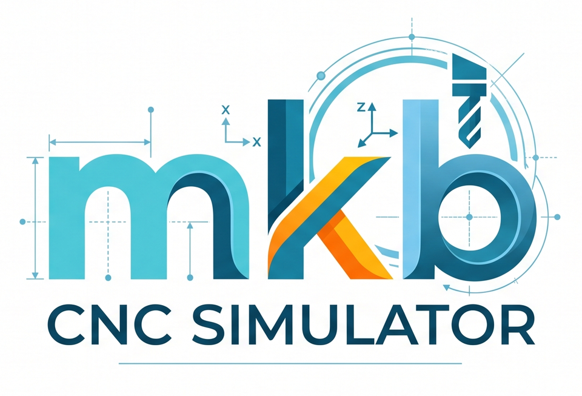

# MKB CNC Simulator (Torna + Freze)

G-kod programlarını yorumlayıp talaş kaldırmayı 3B olarak canlandıran eğitim amaçlı simülatör. Takım kütüphanesi,
kontrol paneli eğitimi, çevrim eğitimi ve kontrol ünitesi simülatörü tek uygulamada birleşiktir.

## Çalıştırma

Gereksinim: Windows + .NET 8 SDK (veya Visual Studio 2022, ".NET masaüstü geliştirme" iş yükü).
